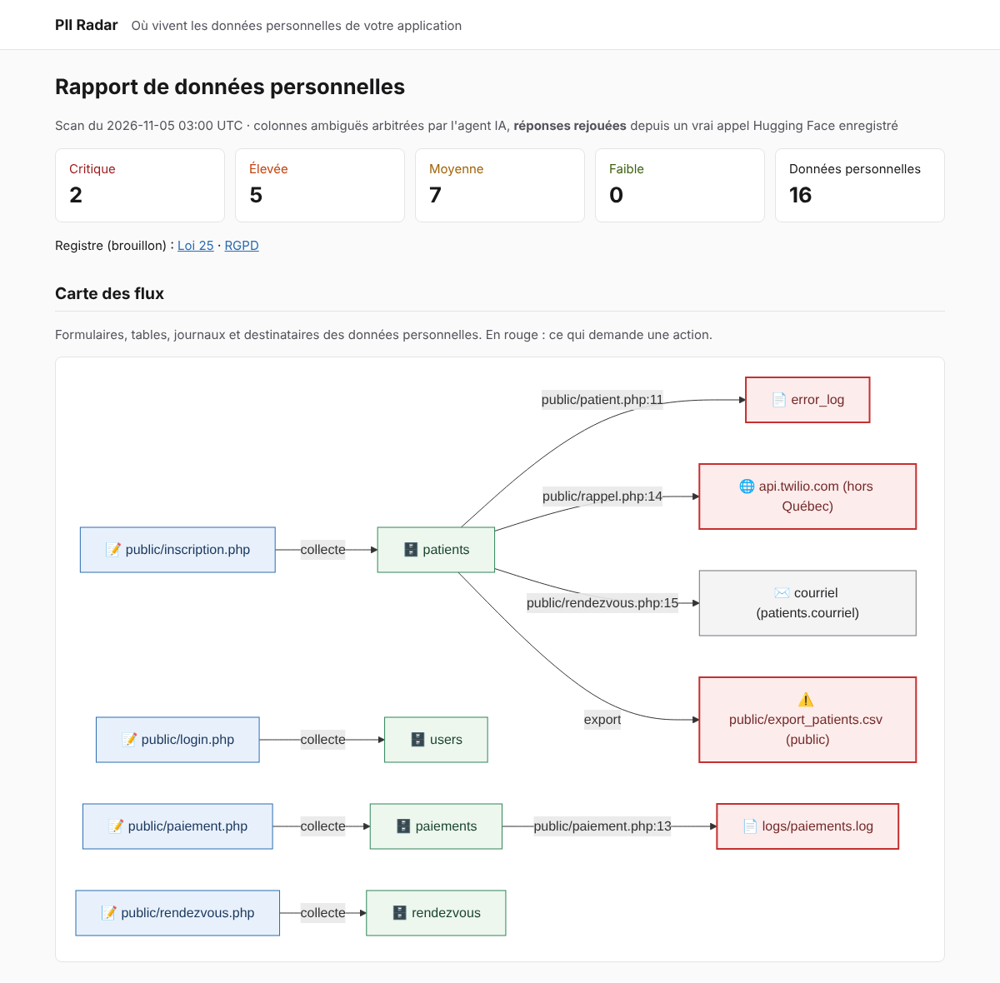
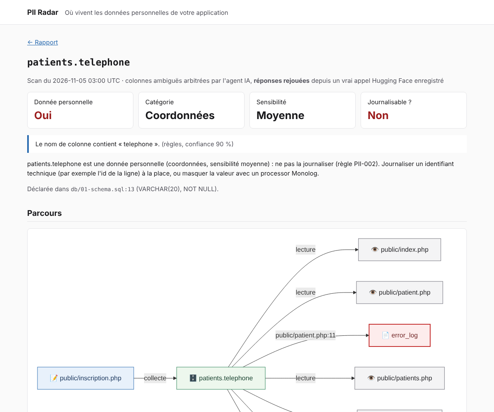

# PII Radar

[](https://github.com/olarno/PII-Radar/actions/workflows/ci.yml)

**PII Radar trouve où une application PHP legacy stocke, journalise et fait fuiter des données personnelles, puis produit un brouillon de registre Loi 25 / RGPD.** La carte des données est exposée en serveur MCP : votre assistant de code peut demander « où vit le courriel du patient ? » ou « ai-je le droit de logger ce champ ? » avant d'écrire une ligne.

100 % PHP, construit avec [Symfony AI](https://symfony.com/doc/current/ai/index.html) et le [SDK MCP PHP](https://github.com/modelcontextprotocol/php-sdk) pour le Symfony AI & MCP Hackathon.

> **Avertissement :** PII Radar produit un *brouillon* d'inventaire pour aider la démarche de conformité. Ce n'est pas un avis juridique.



## Essayer en 5 minutes

Il faut **Docker avec Compose v2** et **git**. Aucune clé, aucun compte : l'appli de démo et un vrai appel de l'agent enregistré sont fournis.

### 1. Démarrer (2 à 4 minutes au premier lancement)

```bash
git clone https://github.com/olarno/PII-Radar.git && cd PII-Radar
docker compose up -d --wait
```

`--wait` rend la main quand tout répond. Les ports 8080 ou 8081 sont déjà pris ? `APP_PORT=8090 LEGACY_APP_PORT=8091 docker compose up -d --wait`, puis remplacez les ports dans les adresses ci-dessous.

L'application auditée est **Clinique Bonsoir**, un faux back-office de clinique écrit « comme en 2014 » : http://localhost:8081 (compte `reception@clinique-bonsoir.test` / `bonsoir`). Toutes les personnes y sont fictives.

### 2. Scanner l'appli de démo

```bash
docker compose exec app bin/console pii:scan demo/legacy-app --replay
```

Le scan lit le schéma SQL et le code PHP, suit les données personnelles, puis applique les règles PII-001 à PII-008 : **14 findings**, dont un NAM écrit dans `error_log`, des mots de passe en MD5, un export CSV public et des téléphones envoyés à Twilio, hors Québec.

Les colonnes ambiguës (`patients.nom`, `rendezvous.motif` et deux pièges, `email_template` et `ville_reference.nom`) sont arbitrées par l'agent Symfony AI. `--replay` rejoue un **vrai appel Hugging Face enregistré** : aucune clé, aucun appel réseau, et la sortie le signale. Pour un appel réel, voir [Avec votre token Hugging Face](#avec-votre-token-hugging-face).

### 3. Ouvrir le rapport

**http://localhost:8080/report** : findings avec preuve et correctif, données personnelles avec qui a décidé et pourquoi, carte des flux. Cliquez sur `patients.telephone` pour voir son parcours : collecté à l'inscription, journalisé, envoyé à Twilio, présent dans l'export public.

### 4. Générer le brouillon de registre

```bash
docker compose exec app bin/console pii:register                  # Loi 25
docker compose exec app bin/console pii:register --format=rgpd    # RGPD, article 30
```

Tout ce qui ne se déduit pas du code (finalités, durées de conservation, responsable, ententes avec les tiers) est marqué « à confirmer par le responsable ».

### 5. Demander à votre assistant de code

Avec [Claude Code](https://docs.claude.com/en/docs/claude-code), lancez `claude` dans le dossier du projet et acceptez le serveur `pii-radar` : le fichier [`.mcp.json`](.mcp.json) le branche via `docker compose`. Claude Code demande ensuite l'autorisation la première fois qu'il utilise chaque outil : acceptez (« Yes, and don't ask again » pour ne plus être interrompu). Refuser affiche « Interrupted · What should Claude do instead? ». Puis demandez :

- « Ai-je le droit de logger `patients.nam` ? »
- « Où vit le courriel du patient ? »
- « Ajoute un log de debug du dossier patient dans `rappel.php` » : l'assistant consulte PII Radar et propose de ne journaliser que l'identifiant technique.

Pour un autre client MCP, le serveur répond en STDIO (`docker compose exec -T app bin/console mcp:server`) et en HTTP (`http://localhost:8080/mcp/pii_radar`).

## Avec votre token Hugging Face

Pour que l'agent appelle réellement le modèle :

1. Créez un token sur https://huggingface.co/settings/tokens : type **Fine-grained**, permission **« Make calls to Inference Providers »**.
2. Mettez-le dans `.env.local`, qui n'est jamais versionné : `echo "HUGGINGFACE_API_KEY=hf_..." > .env.local`
3. `docker compose exec app bin/console pii:scan demo/legacy-app`

Un scan de la démo fait une dizaine d'appels au modèle pour environ 13 000 tokens en entrée (affichés à la fin du scan) : de l'ordre d'un cent. Le modèle par défaut est `openai/gpt-oss-120b`, modifiable avec `PII_RADAR_MODEL`. Sans token, `--no-ai` lance un scan déterministe où l'heuristique décide seule.

## Auditer votre application

```bash
git clone <votre-appli> audited/mon-appli           # le dossier audited/ est ignoré par git
docker compose exec app bin/console pii:scan audited/mon-appli
echo "PII_RADAR_PROJECT=audited/mon-appli" >> .env.local   # le rapport web et le serveur MCP la suivent
```

PII Radar lit les fichiers `.sql` (schéma écrit à la main ou `mysqldump`) et le code PHP. Il n'écrit jamais dans l'application auditée et ne se connecte pas à sa base.

## Ce que fait PII Radar

Le déterministe d'abord, le LLM pour arbitrer et expliquer :

1. **Schéma :** chaque colonne des `CREATE TABLE` est classée par son nom, en français et en anglais (`date_naissance`, `dateOfBirth`, `nam`, `courriel`…).
2. **Code :** `nikic/php-parser` suit les données dans les formulaires, les requêtes SQL, les journaux, les appels HTTP, les courriels et les hachages, avec fichier et ligne.
3. **Agent :** les seules colonnes ambiguës (confiance < 0,8) sont arbitrées par un agent Symfony AI qui enquête avec ses outils (`describe_table`, `find_column_usages`, `read_code_snippet`). **Il ne voit jamais une valeur** : seulement des métadonnées et du code masqué (`[COURRIEL]`, `[NAM]`, `[TELEPHONE]`…).
4. **Règles :**

   | Règle | Détecte |
   |---|---|
   | PII-001 | Donnée sensible stockée en clair |
   | PII-002 | Donnée personnelle écrite dans un journal |
   | PII-003 | Donnée personnelle envoyée à un tiers non déclaré |
   | PII-004 | Requête SQL concaténée avec une donnée personnelle |
   | PII-005 | Mot de passe haché faiblement ou stocké en clair |
   | PII-006 | Aucune trace de suppression des données |
   | PII-007 | Export ou dump dans le webroot |
   | PII-008 | Communication hors Québec (EFVP à réaliser) |

5. **Sorties :** commande `pii:scan` (tableau ou `--format=json`), rapport web, registre Loi 25 / RGPD, serveur MCP. Chaque scan est enregistré dans `var/pii-radar/` : les questions au serveur MCP et le rapport ne relancent pas le LLM.



### Serveur MCP

| Capacité | Nom | Rôle |
|---|---|---|
| Outil | `pii_where_is` | Où vit une donnée (« courriel du patient », `patients.nam`) |
| Outil | `pii_can_i_log` | Un champ peut-il être journalisé ? Réponse, règle, alternative, fuites existantes |
| Outil | `pii_findings` | Findings filtrés par sévérité, fichier ou règle |
| Outil | `pii_scan` | Relance un scan (appelle le LLM, sauf `withAgent: false`) |
| Ressource | `pii://register` | Brouillon de registre Loi 25 |
| Ressource | `pii://register/rgpd` | Brouillon de registre RGPD (art. 30) |
| Modèle de ressource | `pii://field/{table}/{column}` | Fiche complète d'un champ |
| Prompt | `pii-review` | Revue d'un diff sous l'angle des données personnelles |

## Ce que Symfony AI et MCP ont débloqué

- **Un agent qui enquête au lieu de deviner.** `symfony/ai-agent` et des outils `#[AsTool]` laissent le modèle lire la table, les usages d'une colonne et le code avant de trancher. Les deux pièges de la démo sont rejetés avec une justification qui cite la preuve.
- **Enquête, puis verdict structuré.** Les fournisseurs Hugging Face refusent les outils et la sortie structurée dans la même requête. Deux agents déclarés dans `config/packages/ai.yaml` : `arbiter` enquête avec ses outils, `verdicts` rend une sortie structurée (`response_format`) sans outils ([décision 16](docs/decisions.md)).
- **Le LLM ne voit jamais une donnée personnelle.** L'outil de lecture de code passe chaque extrait dans un masqueur, et un test vérifie ce qui atteint réellement le modèle.
- **Des tests qui rejouent le vrai modèle.** Le `CassetteHttpClient` de `symfony/ai-platform` enregistre un vrai appel Hugging Face (identifiants retirés) ; la CI le rejoue à chaque push, sans clé, et c'est le même enregistrement que `pii:scan --replay`.
- **Un modèle indépendant du fournisseur.** Le bridge Hugging Face d'Inference Providers donne accès à des dizaines de modèles avec appel d'outils ; le modèle est une variable d'environnement.
- **Le serveur MCP dans l'appli Symfony.** `symfony/mcp-bundle` découvre les `#[McpTool]`, `#[McpResource]`, `#[McpResourceTemplate]` et `#[McpPrompt]` de `src/Infrastructure/Mcp`, servis en STDIO et en HTTP avec un seul code.

## Développement

```bash
docker compose exec app composer qa   # CS-Fixer, PHPStan niveau max, Deptrac, PHPUnit
```

- **Architecture en couches**, vérifiée par Deptrac : `Domain` (PHP pur, aucune dépendance) ← `Application` ← `Infrastructure` ← `UI`. Les règles PII-001 à PII-008 sont des fonctions pures du domaine.
- **Contrat de bout en bout :** [`demo/legacy-app/expected-findings.json`](demo/legacy-app/expected-findings.json) décrit les 14 findings plantés, les 16 données personnelles et les pièges. Les tests exigent tout le contrat et rien de plus.
- **Aucune clé pour les tests.** Pour réenregistrer l'appel de l'agent après une modification du prompt, des outils ou de la démo :

  ```bash
  rm demo/replay/agent-arbitration.json
  docker compose exec -e HUGGINGFACE_API_KEY=hf_... app vendor/bin/phpunit tests/E2E/DemoArbitrationTest.php
  ```

- **Décisions de conception :** [`docs/decisions.md`](docs/decisions.md).

| Variable | Rôle | Défaut |
|---|---|---|
| `HUGGINGFACE_API_KEY` | Token Hugging Face de l'agent (dans `.env.local`) | vide |
| `PII_RADAR_MODEL` | Modèle de l'agent (appel d'outils et sortie structurée requis) | `openai/gpt-oss-120b` |
| `PII_RADAR_PROJECT` | Application suivie par le rapport web et le serveur MCP | `demo/legacy-app` |
| `APP_PORT`, `LEGACY_APP_PORT` | Ports publiés par Docker Compose | `8080`, `8081` |

## Limites

- PHP seulement, schéma lu depuis des fichiers `.sql`.
- Le suivi des données reste dans un fichier : il ne suit ni les inclusions ni les appels de fonctions.
- Le nom d'une colonne et l'examen de son code ne disent rien de sa finalité ni de sa durée de conservation : le registre les laisse à confirmer.
- Le rejeu `--replay` ne fonctionne que sur l'appli de démo.

## Licence

MIT
