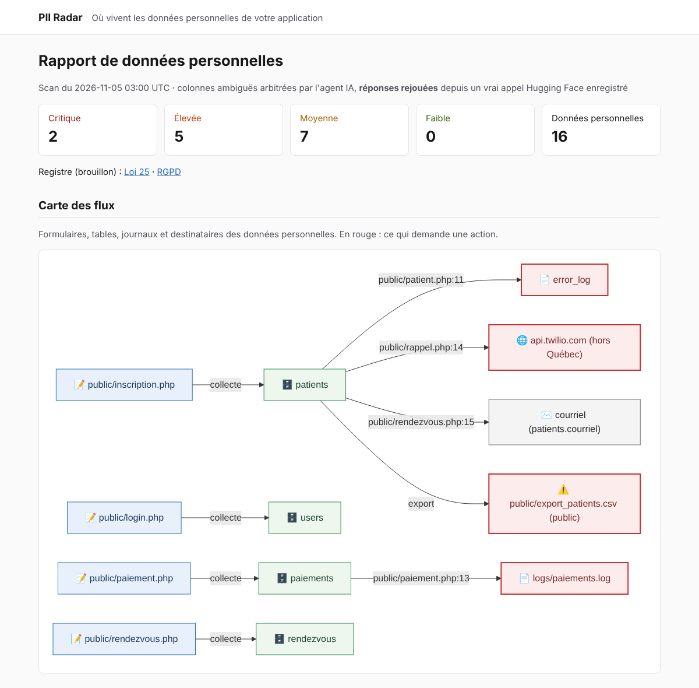
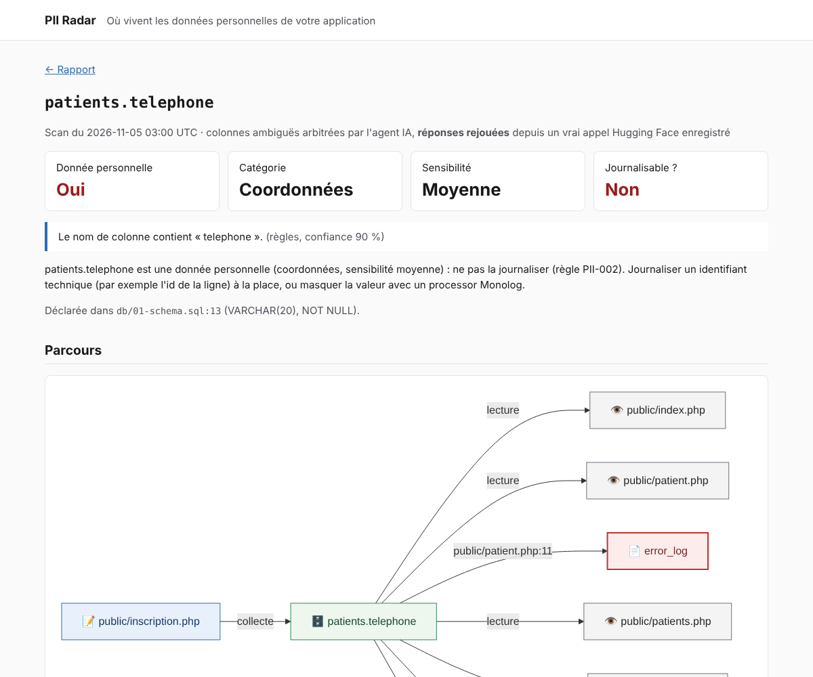

# PII Radar

[](https://github.com/olarno/PII-Radar/actions/workflows/ci.yml)

**PII Radar finds where a legacy PHP application stores, logs and leaks personal data, then drafts a Quebec Law 25 / GDPR register.** The data map is exposed as an MCP server: your coding assistant can ask "where does the patient email live?" or "may I log this field?" before writing a single line.

100% PHP, built with [Symfony AI](https://symfony.com/doc/current/ai/index.html) and the [MCP PHP SDK](https://github.com/modelcontextprotocol/php-sdk) for the Symfony AI & MCP Hackathon.

> **Disclaimer:** PII Radar produces a *draft* inventory to support compliance work. It is not legal advice.



## Try it in 5 minutes

You need **Docker with Compose v2** and **git**. No key, no account: the demo app and a real recorded agent call are included.

### 1. Start (2 to 4 minutes the first time)

```bash
git clone https://github.com/olarno/PII-Radar.git && cd PII-Radar
docker compose up -d --wait
```

`--wait` returns once everything answers. Ports 8080 or 8081 already taken? `APP_PORT=8090 LEGACY_APP_PORT=8091 docker compose up -d --wait`, then change the ports in the addresses below.

The audited application is **Clinique Bonsoir**, a fake clinic back office written "like in 2014", in French as a Quebec clinic's would be: http://localhost:8081 (account `reception@clinique-bonsoir.test` / `bonsoir`). Every person in it is fictitious.

### 2. Scan the demo app

```bash
docker compose exec app bin/console pii:scan demo/legacy-app --replay
```

The scan reads the SQL schema and the PHP code, tracks personal data, then applies rules PII-001 to PII-008: **14 findings**, including a health insurance number (NAM) written to `error_log`, MD5 passwords, a public CSV export and phone numbers sent to Twilio, outside Quebec.

Ambiguous columns (`patients.nom`, `rendezvous.motif` and two traps, `email_template` and `ville_reference.nom`) are arbitrated by the Symfony AI agent. `--replay` replays a **real recorded Hugging Face call**: no key, no network call, and the output says so. For a live call, see [With your Hugging Face token](#with-your-hugging-face-token).

### 3. Open the report

**http://localhost:8080/report**: findings with evidence and fix, personal data with who decided and why, flow map. Click `patients.telephone` to see its journey: collected at signup, logged, sent to Twilio, present in the public export.

### 4. Generate the draft register

```bash
docker compose exec app bin/console pii:register                  # Quebec Law 25
docker compose exec app bin/console pii:register --format=gdpr    # GDPR, article 30
```

Everything that cannot be inferred from code (purposes, retention periods, person in charge, agreements with third parties) is marked "to be confirmed".

### 5. Ask your coding assistant

With [Claude Code](https://docs.claude.com/en/docs/claude-code), run `claude` in the project folder and accept the `pii-radar` server: the [`.mcp.json`](.mcp.json) file connects it through `docker compose`. Claude Code then asks for permission the first time it uses each tool: accept ("Yes, and don't ask again" to stop being asked). Declining shows "Interrupted · What should Claude do instead?". Then ask:

- "May I log `patients.nam`?"
- "Where does the patient email live?"
- "Add a debug log of the patient record in `rappel.php`": the assistant checks PII Radar and suggests logging only the technical identifier.

For another MCP client, the server answers over STDIO (`docker compose exec -T app bin/console mcp:server`) and HTTP (`http://localhost:8080/mcp/pii_radar`).

## With your Hugging Face token

To have the agent really call the model:

1. Create a token at https://huggingface.co/settings/tokens: type **Fine-grained**, permission **"Make calls to Inference Providers"**.
2. Put it in `.env.local`, which is never versioned: `echo "HUGGINGFACE_API_KEY=hf_..." > .env.local`
3. `docker compose exec app bin/console pii:scan demo/legacy-app`

A scan of the demo makes about ten model calls for about 13,000 input tokens (shown at the end of the scan): around one cent. The default model is `openai/gpt-oss-120b`, configurable with `PII_RADAR_MODEL`. Without a token, `--no-ai` runs a deterministic scan where the heuristic decides alone.

## Audit your own application

```bash
git clone <your-app> audited/my-app                  # the audited/ folder is ignored by git
docker compose exec app bin/console pii:scan audited/my-app
echo "PII_RADAR_PROJECT=audited/my-app" >> .env.local   # the web report and the MCP server follow it
```

PII Radar reads `.sql` files (hand-written schema or `mysqldump`) and the PHP code. It never writes to the audited application and never connects to its database.

## What PII Radar does

Deterministic first, the LLM to arbitrate and explain:

1. **Schema:** each column of the `CREATE TABLE` statements is classified by its name, in French and English (`date_naissance`, `dateOfBirth`, `nam`, `courriel`…).
2. **Code:** `nikic/php-parser` tracks data through forms, SQL queries, logs, HTTP calls, e-mails and hashes, with file and line.
3. **Agent:** only the ambiguous columns (confidence < 0.8) are arbitrated by a Symfony AI agent that investigates with its tools (`describe_table`, `find_column_usages`, `read_code_snippet`). **It never sees a value**: only metadata and masked code (`[EMAIL]`, `[NAM]`, `[PHONE]`…).
4. **Rules:**

   | Rule | Detects |
   |---|---|
   | PII-001 | Sensitive data stored in clear |
   | PII-002 | Personal data written to a log |
   | PII-003 | Personal data sent to an undeclared third party |
   | PII-004 | SQL query concatenated with personal data |
   | PII-005 | Password weakly hashed or stored in clear |
   | PII-006 | No sign of retention or deletion |
   | PII-007 | Export or dump in the webroot |
   | PII-008 | Personal information communicated outside Quebec (PIA required) |

5. **Outputs:** `pii:scan` command (table or `--format=json`), web report, Law 25 / GDPR register, MCP server. Each scan is stored in `var/pii-radar/`: questions to the MCP server and the report never run the LLM again.



### MCP server

| Capability | Name | Role |
|---|---|---|
| Tool | `pii_where_is` | Where a piece of data lives ("patient email", `patients.nam`) |
| Tool | `pii_can_i_log` | May a field be logged? Answer, rule, alternative, existing leaks |
| Tool | `pii_findings` | Findings filtered by severity, file or rule |
| Tool | `pii_scan` | Runs a new scan (calls the LLM, unless `withAgent: false`) |
| Resource | `pii://register` | Draft Law 25 register |
| Resource | `pii://register/gdpr` | Draft GDPR register (art. 30) |
| Resource template | `pii://field/{table}/{column}` | Full sheet of a field |
| Prompt | `pii-review` | Review of a diff from the personal data angle |

## What Symfony AI and MCP unlocked

- **An agent that investigates instead of guessing.** `symfony/ai-agent` and `#[AsTool]` tools let the model read the table, the usages of a column and the code before deciding. Both demo traps are rejected with a justification that cites the evidence.
- **Investigation, then structured verdict.** Hugging Face providers reject tools and structured output in the same request. Two agents are declared in `config/packages/ai.yaml`: `arbiter` investigates with its tools, `verdicts` returns structured output (`response_format`) without tools ([decision 16](docs/decisions.md)).
- **The LLM never sees personal data.** The code-reading tool passes every excerpt through a masker, and a test checks what actually reaches the model.
- **Tests that replay the real model.** The `CassetteHttpClient` of `symfony/ai-platform` records a real Hugging Face call (credentials removed); CI replays it on every push, without a key, and it is the same recording as `pii:scan --replay`.
- **A provider-independent model.** The Hugging Face Inference Providers bridge gives access to dozens of models with tool calling; the model is an environment variable.
- **The MCP server inside the Symfony app.** `symfony/mcp-bundle` discovers the `#[McpTool]`, `#[McpResource]`, `#[McpResourceTemplate]` and `#[McpPrompt]` of `src/Infrastructure/Mcp`, served over STDIO and HTTP with a single codebase.

## Development

```bash
docker compose exec app composer qa   # CS-Fixer, PHPStan max level, Deptrac, PHPUnit
```

- **Layered architecture**, checked by Deptrac: `Domain` (pure PHP, no dependency) ← `Application` ← `Infrastructure` ← `UI`. Rules PII-001 to PII-008 are pure domain functions.
- **End-to-end contract:** [`demo/legacy-app/expected-findings.json`](demo/legacy-app/expected-findings.json) describes the 14 planted findings, the 16 pieces of personal data and the traps. Tests require the whole contract and nothing more.
- **No key for tests.** To record the agent call again after changing the prompt, the tools or the demo:

  ```bash
  rm demo/replay/agent-arbitration.json
  docker compose exec -e HUGGINGFACE_API_KEY=hf_... app vendor/bin/phpunit tests/E2E/DemoArbitrationTest.php
  ```

- **Design decisions:** [`docs/decisions.md`](docs/decisions.md).

| Variable | Role | Default |
|---|---|---|
| `HUGGINGFACE_API_KEY` | Hugging Face token of the agent (in `.env.local`) | empty |
| `PII_RADAR_MODEL` | Agent model (tool calling and structured output required) | `openai/gpt-oss-120b` |
| `PII_RADAR_PROJECT` | Application followed by the web report and the MCP server | `demo/legacy-app` |
| `APP_PORT`, `LEGACY_APP_PORT` | Ports published by Docker Compose | `8080`, `8081` |

## Limitations

- PHP only, schema read from `.sql` files.
- Data tracking stays within one file: it follows neither includes nor function calls.
- A column's name and its code say nothing about its purpose or retention period: the register leaves them to be confirmed.
- `--replay` only works on the demo app.

## License

MIT
